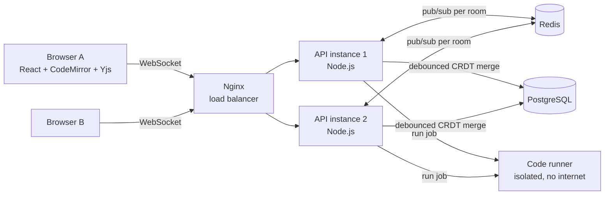

# CodeSync: Real-time Collaborative Code Editor

Write code together in the browser, like Google Docs for code. Share a link, see each other's cursors live, and run **Java, Python, C++, Go, JavaScript and TypeScript** with output that everyone in the room sees.

Under the hood it is a **horizontally scalable real-time system**: conflict-free editing with CRDTs, WebSockets, Redis pub/sub between server instances, Postgres persistence, an Nginx load balancer, and a **sandboxed code-execution service** with no internet access and strict resource limits.


**Live demo:** _add your deployed URL here_ · **Demo video:** _add a 60-second Loom here_

---

## Features

- **Live collaborative editing** with conflict-free merging (Yjs CRDT). Any number of people can type in the same line at once.
- **Live cursors and presence**: coloured, named cursors and an avatar list of who is in the room.
- **Works offline**: keep typing when the connection drops; edits merge automatically on reconnect.
- **Run code in 6 languages**: Java, Python, C++, Go, JavaScript, TypeScript, with a shared **stdin** box for DSA-style input. Output (and compile errors) appear for everyone in the room.
- **Secure execution sandbox**: every run is a separate unprivileged process in an isolated container with no internet, CPU/memory/time/output limits, fork-bomb protection and a per-user rate limit.
- **9 languages** with syntax highlighting; language changes sync to everyone.
- **Per-user undo**: Ctrl+Z undoes *your* edits, never your teammate's.
- **Accounts and rooms**: JWT auth, dashboard of your rooms, share-by-link access, owner-only delete.

## Architecture



**How an edit travels:** Browser A applies the keystroke locally (zero-latency typing) → sends a binary Yjs update over WebSocket → its server instance applies it, broadcasts to its other local clients, and publishes it to the room's Redis channel → the other instance receives it and pushes it to Browser B. A few seconds later, the document is saved to Postgres.

### Key design decisions

| Problem | Decision | Why |
|---|---|---|
| Two people edit the same spot | **CRDT (Yjs)**, not locks or last-write-wins | Every replica converges to the same result with no central coordinator, and offline edits merge cleanly. |
| Users in one room hit different servers | **Redis pub/sub, one channel per room** | No sticky sessions needed, so instances are stateless from the LB's view and can scale out freely. |
| Server joins a room late and misses unsaved edits | **State-vector sync handshake over Redis** | The new instance broadcasts what it has; peers reply with *only* the missing diff. |
| Concurrent saves from multiple instances | **Save = lock row + CRDT merge** | A plain upsert could let a stale snapshot erase newer edits. Merging makes saves commutative, so no write can lose data. |
| Hundreds of keystrokes per minute | **Debounced persistence** (2s idle, 10s max) | Turns ~300 writes into 1 while capping data at risk. |
| Memory with many rooms | **Lazy load, unload when empty** | Memory scales with *active* rooms, not total rooms. |
| Abuse | Auth checked **during the HTTP upgrade**, token-bucket rate limit per socket, payload cap, login rate limit | Unauthenticated clients never get a socket. |
| Dead connections | Ping/pong heartbeat every 30s | Drops ghost users when laptops sleep or networks die. |
| Running untrusted code | **Separate runner service** on an internal-only network; each run drops to an unprivileged user under `prlimit`; read-only container, all capabilities dropped but the few needed | The API never executes code. A malicious program can't reach the internet, the database, or other users' runs. |
| Too many runs at once | **Bounded queue** (N parallel, 20 waiting, then HTTP 429) + 20 runs/min per user | Backpressure: fail fast instead of slowing everyone down. |

More detail in [docs/INTERVIEW_GUIDE.md](docs/INTERVIEW_GUIDE.md).

## Performance

Measured with the included load test (`server/scripts/load-test.ts`): real Yjs WebSocket clients, spread across **two server instances**, each typing 5 edits/second for 20 seconds.

| Metric | Result |
|---|---|
| Concurrent clients | 200 (40 rooms × 5 users) |
| Edits sent | ~990 / s |
| Updates delivered to other users | ~3,950 / s |
| End-to-end latency p50 / p95 / p99 | 1.4 ms / 34.5 ms / 92.8 ms |
| Rooms that converged to identical text | 40 / 40 |

_Measured on a single machine with the load generator, both instances, Postgres and Redis on the same host. Re-run it on your own hardware and update this table._

Frontend: the editor bundle (CodeMirror + 9 grammars) is lazy-loaded, so the login and dashboard pages ship only ~86 KB gzipped.

## Tech stack

**Frontend:** React 19, TypeScript, Vite, CodeMirror 6, Yjs, y-websocket
**Backend:** Node.js, TypeScript, Express 5, ws, Yjs, Zod, JWT, bcrypt, pino
**Data:** PostgreSQL (users, rooms, document snapshots), Redis (pub/sub)
**Code execution:** isolated Node.js service with Python 3, OpenJDK 17, g++ (C++17), Go, Node.js
**Ops:** Docker (multi-stage builds), Docker Compose, Nginx, Caddy (automatic HTTPS), GitHub Actions CI, Prometheus metrics
**Testing:** Vitest, Supertest, real multi-instance integration tests

## Run it

### Option 1: Docker (everything in one command)

```bash
docker compose up --build
```

Open http://localhost:8080 in two browser windows (or one normal + one incognito), sign up as two users, and share the room link.

### Deploy it live

On any Ubuntu server: `bash deploy.sh`. It installs Docker, generates secrets and serves the site over HTTPS. Full walkthrough (free student options, Windows SSH, troubleshooting): [docs/DEPLOYMENT.md](docs/DEPLOYMENT.md).

### Option 2: Local development

Requires Node 20+, PostgreSQL 14+ and Redis 6+ running locally.

```bash
# 1. Database
createuser codesync --pwprompt        # password: codesync
createdb codesync -O codesync

# 2. Backend (http://localhost:4000)
cd server
cp .env.example .env
npm install
npm run dev                           # runs migrations automatically

# 3. Code runner (needs python3, java, g++, go on your PATH; optional)
cd ../runner
npm start

# 4. Frontend (http://localhost:5173)
cd ../client
npm install
npm run dev
```

Tip: start Postgres and Redis quickly with Docker:
`docker run -d -p 5432:5432 -e POSTGRES_USER=codesync -e POSTGRES_PASSWORD=codesync postgres:16-alpine` and `docker run -d -p 6379:6379 redis:7-alpine`.

## Tests

```bash
createdb codesync_test -O codesync
cd server && npm test
```

**Server: 24 tests**, including integration tests that start **two real server instances** sharing Redis and connect real Yjs clients to check:

- edits sync on the same instance and **across instances**
- 4 users typing 100 random concurrent edits across 2 instances all **converge**
- presence appears and disappears across instances
- a late joiner on another instance receives edits that were **never saved** (Redis handshake)
- documents persist to Postgres and reload after everyone leaves
- the CRDT-merge save never loses data from a stale snapshot
- WebSocket upgrades are rejected without a valid token or for unknown rooms
- code runs end to end through the real runner (Java, Python, C++ compile errors), and the API returns 503 cleanly when the runner is down

**Runner: 17 tests** (`cd runner && npm test`): every language with stdin, compile and runtime errors, infinite loops, sleeping programs, output floods, memory bombs, fork bombs, background processes, and file isolation between runs. CI runs them inside the production Docker image.

Load test (with the server running):

```bash
cd server
ROOMS=40 CLIENTS_PER_ROOM=5 DURATION_S=20 npm run load-test
# Two instances:
WS_URLS=ws://localhost:4001/ws,ws://localhost:4002/ws API_URL=http://localhost:4001 npm run load-test
```

## API

| Method | Path | Description |
|---|---|---|
| POST | `/api/auth/register` | `{email, name, password}` → `{token, user}` |
| POST | `/api/auth/login` | `{email, password}` → `{token, user}` |
| GET | `/api/auth/me` | Current user |
| GET | `/api/rooms` | Rooms you own or have joined |
| POST | `/api/rooms` | `{name, language}` → create a room |
| GET | `/api/rooms/:id` | Room details (joins you as editor) |
| PATCH | `/api/rooms/:id` | Update `name` / `language` |
| DELETE | `/api/rooms/:id` | Owner only |
| POST | `/api/rooms/:id/run` | `{language, code, stdin}` → `{result: {phase, stdout, stderr, exitCode, timedOut, durationMs}}` (20/min per user) |
| WS | `/ws/:roomId?token=…` | Yjs sync + awareness protocol |
| GET | `/healthz`, `/readyz` | Liveness / readiness (checks DB + Redis) |
| GET | `/metrics` | Prometheus metrics |

## Project structure

```
server/src/
  collab/
    room.ts          # one shared doc: sync protocol, presence, debounced persistence
    roomManager.ts   # lazy load / unload rooms, dedupe concurrent loads
    bridge.ts        # Redis pub/sub between instances
    docStore.ts      # Postgres snapshots with CRDT-merge saves
    wsServer.ts      # WebSocket upgrade auth, rate limiting, heartbeats
    tokenBucket.ts
  auth/              # register, login, JWT middleware
  rooms/             # REST routes + repository (SQL)
  db/                # pool, migration runner, SQL migrations
  app.ts             # Express app, health checks, metrics
  server.ts          # wires HTTP + WebSocket + Redis + Postgres
server/src/rooms/run.ts  # forwards run jobs to the runner, per-user rate limit
server/tests/        # unit, API and multi-instance integration tests
runner/src/
  sandbox.js         # prlimit, privilege drop, timeouts, output caps, cleanup
  languages.js       # compile/run commands per language
  queue.js           # bounded concurrency queue (backpressure)
  server.js          # internal HTTP API with shared-secret auth
server/scripts/      # load test
client/src/
  lib/useCollabRoom.ts   # WebSocket provider, presence, connection status
  lib/runner.ts          # browser fallback for JavaScript if the runner is offline
  components/CodeEditor.tsx
  pages/                 # Auth, Dashboard, Editor
```

## Roadmap

See [docs/ROADMAP.md](docs/ROADMAP.md): version history, read-only share links, one-time WebSocket tickets, and more.

## License

MIT
